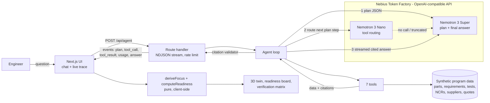

# SpaceGrade Agent

[](LICENSE)


**Live demo:** https://spacegrade-agent.vercel.app · Built for the Nebius x NVIDIA Global AI Hackathon (Best Apps and Agents track)

An engineer types (or says) a hardware question in plain English. SpaceGrade Agent plans with **NVIDIA Nemotron 3 Super**, routes tool calls with **Nemotron 3 Nano**, and reads parts, requirements, test records, nonconformances and supplier quotes. It returns a structured answer, a full engineering document, or a what-if simulation. Every claim cites the record it came from.

It runs as a **mission-control console**: a live **3D digital twin** of the spacecraft sits in the middle, and the camera flies to whichever parts the agent is investigating as each tool returns. Parts glow by qualification status (blocked NCRs pulse red), a readiness board and a requirement verification matrix fill in as the agent reads them, and a telemetry feed on the right shows the plan, each tool call with its arguments, which model made it, and the tokens and cost of every step.

All model calls go through **Nebius Token Factory**.

> All data in this repo is synthetic: KESTREL-1 is a fictional 180 kg smallsat with 50 parts, 36 requirements, 61 test records, 5 nonconformances, 9 suppliers and 3 valve quotes. No SpaceGrade production code or customer data is included.

## Why it matters

Hardware teams in aerospace lose days, and sometimes weeks, chasing status across spreadsheets, PLM exports, test reports and NCR logs. A question like *"what is blocking propulsion qualification?"* means opening four systems and reconciling ids by hand. The answer is only useful if every line can be traced back to a record, because in a qualification review an uncited claim doesn't count.

SpaceGrade Agent asks that question of the data directly. It follows the thread from nonconformance to affected requirement to test evidence, and it refuses to cite anything a tool did not return.

## What it does

| Ask | What happens |
|---|---|
| "Which components on the propulsion assembly have open nonconformances, and what's blocking qualification?" | Plan: NCRs → affected requirements → test evidence. The answer names NCR-001 (valve seat leak) and NCR-002 (catalyst bed heater), the failed tests behind them, and the owners and dates of the next actions. |
| "Is the star tracker ready for CDR? Show the requirements that are not verified yet." | Finds the part, derives verification status from test records (verified, failed, in progress, unverified), and lists what is needed to close each gap, including the open baffle NCR that blocks the sun-exclusion test. |
| "Draft a trade study comparing Halden Valve Works and Corvid Flow Systems for the main isolation valve against our requirements." | Checks each quote against the valve's measurable requirements and drafts a trade-study document. The tables are rendered from the data; Nemotron Super writes only the executive summary and recommendation, with citations. The result can be downloaded as Markdown. |
| "What if NCR-001 is dispositioned and the valve seat leak retest passes? How does propulsion readiness change, and what still blocks qualification?" | Calls `simulate_change`, which recomputes verification with the NCR closed and its failed test retested. The twin, board and matrix re-colour to the simulated state (the valve flashes as it changes), and the answer gives readiness before and after (62% → 69% for propulsion) and the NCRs still blocking. The same what-if can be toggled by hand from the panel on the twin. |

## Architecture



**Loop** (`src/lib/agent/loop.ts`):

1. **Plan.** Super returns 2–5 steps as JSON, each naming one tool. Consecutive duplicate steps are collapsed.
2. **Act.** Each round, Nano gets the plan with `[done]` / `[NEXT]` markers and native OpenAI-style `tools`. If Nano returns no tool call, or runs out of reasoning tokens mid-call, Super takes that step with a *named* `tool_choice` that forces the planned tool. The loop stops as soon as every plan step has run, so no model round is spent just saying "done". A guardrail refuses `draft_document` unless the plan asked for it and the evidence steps before it are complete.
3. **Answer.** Super streams the answer from the tool results only. Every record id in the text is checked against the ids the tools actually returned. Unknown ids are flagged in red in the UI and the trace.

**Tools** (`src/lib/tools/`): `search_parts`, `get_requirements`, `get_test_results`, `list_nonconformances`, `compare_suppliers`, `simulate_change`, `draft_document`. Each is a pure function over the data that returns `{ data, citations, summary }`. Requirement status is *derived* from test records, never stored, and supplier compliance is computed per requirement, not judged by the model.

**Visual layer** (`src/lib/focus.ts`, `src/lib/readiness.ts`, `src/components/twin/`): the UI spends no extra model calls on visuals. `deriveFocus` turns the agent's event stream into the parts it is looking at, because every record id resolves to a part (an NCR, test or quote has a `partId`, a requirement has `partIds`). `computeReadiness` rolls test evidence and NCRs up to requirements, parts and assemblies, optionally under what-if overrides. The same function backs the `simulate_change` tool, so the twin shows exactly what the agent computed. The twin is a procedural react-three-fiber model where every mesh belongs to a part id; it is code-split and falls back to a 2D schematic without WebGL. Status colours were checked for colour-vision deficiency, and status never relies on colour alone.

## Flight Mode (`/flight`): the build pedigree as a virtual sensor


Spacecraft are short on sensors, because every sensor costs money, mass and power. So a symptom in orbit usually fits more than one cause. Ground engineers settle it from the records ("that valve had a seat-leak NCR, use-as-is"), but that history lives in PLM and QMS systems and in people's heads, not in the loop. Flight Mode puts it in the loop. A ground autonomy agent is woken by onboard fault detection while nobody is on console. It reads the telemetry, then the vehicle's **build pedigree**, and reasons about what this particular vehicle is doing.

Each scenario turns a record that already exists in the program data into a flight problem:

| Scenario | Symptom | Record that explains it | What a spec-sheet model gets wrong | Outcome |
|---|---|---|---|---|
| Slow pressure loss | Temperature-compensated tank pressure trends −0.087 psi/day | NCR-001: the isolation valve seat leaked 3.2e-4 scc/s in qualification | Sees noise or "a leak somewhere"; nothing projects end of life | Inferred leak is 3.2e-4 scc/s, the same as NCR-001. Stranded propellant takes delta-v below REQ-SYS-002 by mission day ~710. A propulsion procedure waits for operator approval and a flight NCR goes back to the build record |
| Conjunction, nobody on console | Pc 2.1e-4, closest approach in 118 min | NCR-002: the catalyst bed heater is 52 Ω and reaches only 290 °C at 30 min | Preheat 30 min, so the decision deadline is T+45, after the T+38 pass, and a human could decide | As-built preheat is 43 min, so the deadline is T+32, **before** the pass. The policy executes the burn autonomously, and the miss distance grows from 180 m to 1.2 km |
| Eclipse power with weak cells | End-of-eclipse voltage 0.04 V below model, three eclipses running | NCR-005: cell lot L-2611 has 9.6 Ah against 10.0 Ah | The next eclipse with an X-band downlink is 19.6% depth of discharge, inside the 20% limit | As-built it is 20.4%, over the REQ-PWR-021 limit. The policy sheds the payload session autonomously, giving 17.4% |

**The agent proposes; a deterministic policy decides.** The LLM never commands the vehicle. `propose_action` submits a proposal to `src/lib/flight/autonomy.ts`, which checks an envelope (for example Δv ≤ 0.5 m/s and the delta-v budget kept) and sets the tier from one question: *can an operator be reached before the decision deadline?* If not, pre-approved action classes execute and are logged. If so, they wait for approval. Propulsion procedures always wait. In the eval, Nano's own rationale sometimes gets the timing wrong; the policy is the source of truth, and the decision card shows its checks.

**How it is built.** The same agent loop runs with an `AgentMode` (flight tools, context, answer rules). `get_telemetry` reads only up to "now". `get_part_history` returns the pedigree, including NCRs on sibling parts in the same system. The other tools are `get_contact_windows`, `propose_action` and `draft_flight_ncr`. The simulation (`src/lib/flight/`) is seeded and pure, and its model parameters come from record values, such as heater resistance into the preheat curve, the leak rate into blowdown, and cell capacity into depth of discharge. Fault detection is a fixed rule set with no model in it. `npm run eval:flight` runs all three scenarios headless and checks the cited record and the tier (~$0.015 for all three).

**Roadmap.** (1) Today: an always-on ground agent. (2) Compile what it learns into onboard tables, such as thresholds and models tuned to the as-built vehicle. (3) Onboard reasoning on payload-class compute, for decisions that are not flight-critical. Next scenario: IMU drift during star tracker dropouts near the sun-exclusion angle, which NCR-004's thin baffle anodize explains.

## How we use Nemotron and Nebius Token Factory

- **One client, one provider.** `src/lib/nebius.ts` builds the `openai` SDK client with `baseURL = NEBIUS_BASE_URL` and `apiKey = NEBIUS_API_KEY`. No other model provider is installed or called.
- **Two models with different jobs.** Model ids live in `agent.config.ts` and can be overridden with the `PLANNER_MODEL` and `ROUTER_MODEL` env vars:
  - `nvidia/nemotron-3-super-120b-a12b` handles planning, fallback routing, and the final cited answer and document narrative.
  - `nvidia/NVIDIA-Nemotron-3-Nano-30B-A3B` handles per-step tool routing.
  - Swapping in Nemotron 3 Ultra (`nvidia/Nemotron-3-Ultra-550b-a55b`) is one env var.
- **Native tool calling.** We use OpenAI-format `tools` and `tool_calls` on Token Factory, including a named `tool_choice` to force a specific function when the router declines.
- **Reasoning is shown, not hidden.** Token Factory returns Nemotron's reasoning in a separate `reasoning_content` field. The trace shows it per step, collapsed by default.
- **Streaming with usage.** The final answer streams (`stream: true`, `stream_options.include_usage`), so text appears as it is written and the run still gets exact token counts.
- **Cost accounting.** Every call logs prompt and completion tokens, latency and estimated cost, using Token Factory list prices in `agent.config.ts`: $0.30/$0.90 per 1M tokens for Super and $0.06/$0.24 for Nano. Measured on the four demo queries, a run costs **$0.002–0.006** and takes 15–55 s. A per-run token cap (60k) and a per-IP limit (10 runs/hour) keep the public demo's total spend far under the $50 budget.

## What was built during the hackathon

SpaceGradeOS, a hardware lifecycle platform, existed before the hackathon. It runs on a different model stack, and none of its code is in this repo. Everything here was written during the hackathon:

- A Nebius Token Factory client and model config, plus a smoke test that lists Nemotron models and checks completions and tool calling.
- A synthetic KESTREL-1 program dataset designed around realistic qualification problems.
- Seven citation-returning tools, including a what-if simulator, and the requirement-verification and supplier-compliance logic behind them.
- The plan → route → answer loop on Nemotron Super and Nano, with forced-tool fallback, a document guardrail, auto-stop and the citation validator.
- The mission-control UI: a 3D digital twin that follows the agent, a readiness board, a requirement verification matrix, a what-if panel, voice questions, a telemetry trace, record drawer and document view.
- A headless eval (`npm run eval`) that runs the four demo queries and checks the expected citations, that no id is unknown, and that the document is complete.

## Run it locally

```bash
git clone https://github.com/geobond13/spacegrade-agent && cd spacegrade-agent
npm install
cp .env.example .env.local     # then set NEBIUS_API_KEY
npm run smoke                  # lists Nemotron models, runs Super + Nano + one tool call
npm test                       # 47 unit tests: tools, citations, guardrails, readiness, focus, what-if, flight physics, FDIR, autonomy policy
npm run eval                   # the 4 demo queries end to end, with token/cost totals
npm run eval:flight            # the 3 Flight Mode scenarios: cited record + autonomy tier
npm run dev                    # http://localhost:3000
```

Requirements: Node 22+ and a Nebius Token Factory API key. To deploy, import the repo into Vercel and set `NEBIUS_API_KEY` and `NEBIUS_BASE_URL`.

## Repo map

```
agent.config.ts            model ids, caps, prices
src/data/                  synthetic program + types
src/lib/nebius.ts          the only LLM client
src/lib/tools/             seven tools + tests
src/lib/agent/             loop, prompts, citation validator, plan progress, events
src/lib/readiness.ts       readiness roll-up and what-if overrides
src/lib/focus.ts           agent events -> parts in focus
src/app/api/agent/route.ts streaming endpoint
src/components/            console shell, board, matrix, what-if, voice, trace, drawers
src/components/twin/       3D model, canvas, 2D schematic fallback
src/lib/flight/            Flight Mode sim: physics from records, scenarios, FDIR, autonomy policy, part health
src/lib/tools/flight/      flight tools
src/components/flight/     /flight UI: telemetry strips, operations timeline, decision cards
scripts/                   smoke test, eval
docs/                      demo script, Devpost text
```

## Limitations

- The data is a small synthetic program held in memory. A real deployment would read the same shapes from a PLM/QMS database.
- The rate limiter is per server instance and best-effort.
- Answers are drafts for engineering review. The agent reads records; it does not change them. What-if results are simulations and are labelled as such.
- Flight Mode is a simulation on synthetic data, with simplified physics. It is not flight software, and the autonomy policy is illustrative.
- Voice input uses the browser's speech recognition (Chrome, Edge, Safari) and is hidden elsewhere.

## License

MIT. See [LICENSE](LICENSE).
