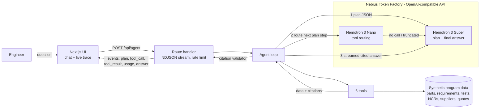

# SpaceGrade Agent

[](LICENSE)

**Live demo:** https://spacegrade-agent.vercel.app · Built for the Nebius x NVIDIA Global AI Hackathon (Best Apps and Agents track)

An engineer types a hardware question in plain English. SpaceGrade Agent plans with **NVIDIA Nemotron 3 Super**, routes tool calls with **Nemotron 3 Nano**, and reads parts, requirements, test records, nonconformances and supplier quotes. It returns a structured answer or a full engineering document. Every claim cites the record it came from. A live trace beside the chat shows the plan, each tool call with its arguments, which model made it, and the tokens and cost of every step.

All model calls go through **Nebius Token Factory**.

> All data in this repo is synthetic: KESTREL-1 is a fictional 180 kg smallsat with 50 parts, 36 requirements, 61 test records, 5 nonconformances, 9 suppliers and 3 valve quotes. No SpaceGrade production code or customer data is included.

## Why it matters

Hardware teams in aerospace lose days, and sometimes weeks, chasing status across spreadsheets, PLM exports, test reports and NCR logs. A question like *"what is blocking propulsion qualification?"* means opening four systems and reconciling ids by hand. The answer is only useful if every line can be traced back to a record, because in a qualification review an uncited claim doesn't count.

SpaceGrade Agent asks that question of the data directly. It follows the thread from nonconformance to affected requirement to test evidence, and it refuses to cite anything a tool did not return.

## What it does

| Ask | What happens |
|---|---|
| "Which components on the propulsion assembly have open nonconformances, and what's blocking qualification?" | Plan: NCRs → affected requirements → test evidence. The answer names NCR-001 (valve seat leak) and NCR-002 (catalyst bed heater), the failed tests behind them, and the owners and dates of the next actions. |
| "Is the star tracker ready for CDR? Show the requirements that are not verified yet." | Finds the part, derives verification status from test records (verified, failed, in progress, unverified), and lists what is needed to close each gap, including the open baffle NCR that blocks the sun-exclusion test. |
| "Draft a trade study comparing Halden Valve Works and Corvid Flow Systems for the main isolation valve against our requirements." | Checks each quote against the valve's measurable requirements and drafts a trade-study document. The tables are rendered from the data; Nemotron Super writes only the executive summary and recommendation, with citations. The result can be downloaded as Markdown. |

## Architecture



**Loop** (`src/lib/agent/loop.ts`):

1. **Plan.** Super returns 2–5 steps as JSON, each naming one tool. Consecutive duplicate steps are collapsed.
2. **Act.** Each round, Nano gets the plan with `[done]` / `[NEXT]` markers and native OpenAI-style `tools`. If Nano returns no tool call, or runs out of reasoning tokens mid-call, Super takes that step with a *named* `tool_choice` that forces the planned tool. The loop stops as soon as every plan step has run, so no model round is spent just saying "done". A guardrail refuses `draft_document` unless the plan asked for it and the evidence steps before it are complete.
3. **Answer.** Super streams the answer from the tool results only. Every record id in the text is checked against the ids the tools actually returned. Unknown ids are flagged in red in the UI and the trace.

**Tools** (`src/lib/tools/`): `search_parts`, `get_requirements`, `get_test_results`, `list_nonconformances`, `compare_suppliers`, `draft_document`. Each is a pure function over the data that returns `{ data, citations, summary }`. Requirement status is *derived* from test records, never stored, and supplier compliance is computed per requirement, not judged by the model.

## How we use Nemotron and Nebius Token Factory

- **One client, one provider.** `src/lib/nebius.ts` builds the `openai` SDK client with `baseURL = NEBIUS_BASE_URL` and `apiKey = NEBIUS_API_KEY`. No other model provider is installed or called.
- **Two models with different jobs.** Model ids live in `agent.config.ts` and can be overridden with the `PLANNER_MODEL` and `ROUTER_MODEL` env vars:
  - `nvidia/nemotron-3-super-120b-a12b` handles planning, fallback routing, and the final cited answer and document narrative.
  - `nvidia/NVIDIA-Nemotron-3-Nano-30B-A3B` handles per-step tool routing.
  - Swapping in Nemotron 3 Ultra (`nvidia/Nemotron-3-Ultra-550b-a55b`) is one env var.
- **Native tool calling.** We use OpenAI-format `tools` and `tool_calls` on Token Factory, including a named `tool_choice` to force a specific function when the router declines.
- **Reasoning is shown, not hidden.** Token Factory returns Nemotron's reasoning in a separate `reasoning_content` field. The trace shows it per step, collapsed by default.
- **Streaming with usage.** The final answer streams (`stream: true`, `stream_options.include_usage`), so text appears as it is written and the run still gets exact token counts.
- **Cost accounting.** Every call logs prompt and completion tokens, latency and estimated cost, using Token Factory list prices in `agent.config.ts`: $0.30/$0.90 per 1M tokens for Super and $0.06/$0.24 for Nano. Measured on the three demo queries, a run costs **$0.002–0.006** and takes 20–55 s. A per-run token cap (60k) and a per-IP limit (10 runs/hour) keep the public demo's total spend far under the $50 budget.

## What was built during the hackathon

SpaceGradeOS, a hardware lifecycle platform, existed before the hackathon. It runs on a different model stack, and none of its code is in this repo. Everything here was written during the hackathon:

- A Nebius Token Factory client and model config, plus a smoke test that lists Nemotron models and checks completions and tool calling.
- A synthetic KESTREL-1 program dataset designed around realistic qualification problems.
- Six citation-returning tools and the requirement-verification and supplier-compliance logic behind them.
- The plan → route → answer loop on Nemotron Super and Nano, with forced-tool fallback, a document guardrail, auto-stop and the citation validator.
- The streaming UI: chat, live trace, record drawer and document view.
- A headless eval (`npm run eval`) that runs the demo queries and checks the expected citations, that no id is unknown, and that the document is complete.

## Run it locally

```bash
git clone https://github.com/geobond13/spacegrade-agent && cd spacegrade-agent
npm install
cp .env.example .env.local     # then set NEBIUS_API_KEY
npm run smoke                  # lists Nemotron models, runs Super + Nano + one tool call
npm test                       # 17 unit tests: tools, citations, plan progress, guardrails
npm run eval                   # the 3 demo queries end to end, with token/cost totals
npm run dev                    # http://localhost:3000
```

Requirements: Node 22+ and a Nebius Token Factory API key. To deploy, import the repo into Vercel and set `NEBIUS_API_KEY` and `NEBIUS_BASE_URL`.

## Repo map

```
agent.config.ts            model ids, caps, prices
src/data/                  synthetic program + types
src/lib/nebius.ts          the only LLM client
src/lib/tools/             six tools + tests
src/lib/agent/             loop, prompts, citation validator, plan progress, events
src/app/api/agent/route.ts streaming endpoint
src/components/            chat, trace, record drawer, document view
scripts/                   smoke test, eval
docs/                      demo script, Devpost text
```

## Limitations

- The data is a small synthetic program held in memory. A real deployment would read the same shapes from a PLM/QMS database.
- The rate limiter is per server instance and best-effort.
- Answers are drafts for engineering review. The agent reads records; it does not change them.

## License

MIT. See [LICENSE](LICENSE).
