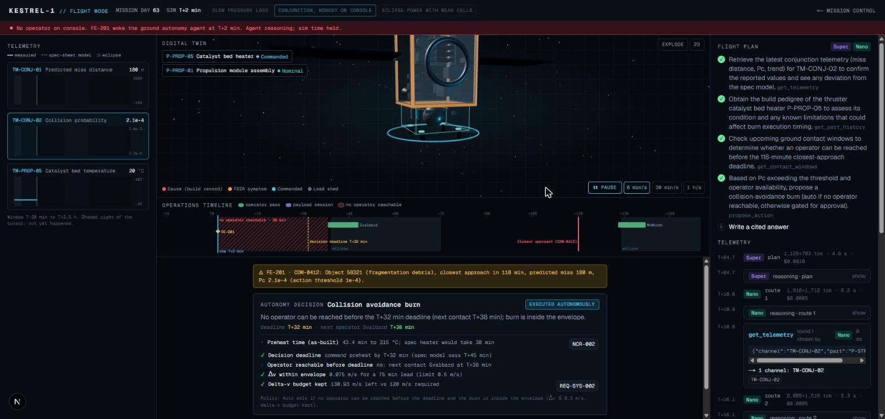
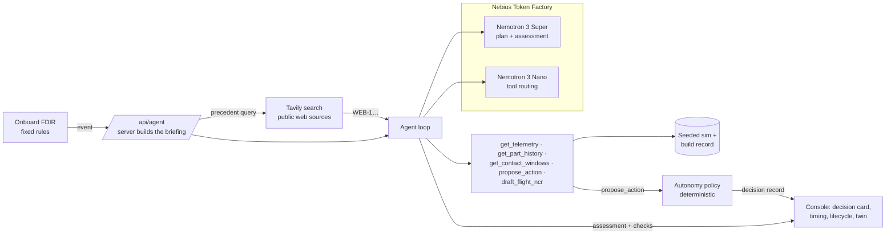
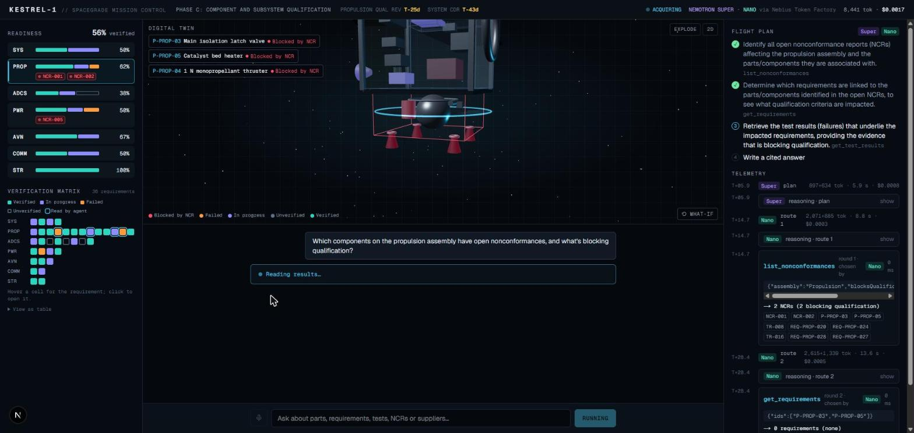

# SpaceGrade Flight Ops

[](LICENSE)



**Live demo:** https://spacegrade-agent.vercel.app · Built for the Nebius x NVIDIA Global AI Hackathon (Apps and Agents)

**A spacecraft's build record changes what it can safely do in orbit.** SpaceGrade Flight Ops is a ground autonomy agent that wakes up when onboard fault detection fires and nobody is on console. It reads the telemetry, then the vehicle's build record: every test, every defect, and how each defect was signed off for flight. Then it proposes an action. A deterministic policy, not the model, decides whether that action runs now, waits for an operator, or is refused.

The agent plans with **NVIDIA Nemotron 3 Super** and routes tool calls with **Nemotron 3 Nano**. All model calls go through **Nebius Token Factory**. Each run also searches public sources with **Tavily** for the same failure mode on other spacecraft, as precedent for the operator.

> All data is synthetic: KESTREL-1 is a fictional 180 kg smallsat with 50 parts, 36 requirements, 61 test records and 5 nonconformances. The flight simulation is simplified physics, not flight software.

## The idea in one example

Debris will pass KESTREL-1 in two hours. Avoiding it takes a thruster burn, and the thrusters have to be preheated first. The next operator is on console at T+38.

| | Spec sheet | This vehicle, as built |
|---|---:|---:|
| Catalyst bed preheat | 30 min | **43.4 min** (NCR-002: heater 52 Ω, accepted for flight under deviation) |
| Latest time to start preheat | T+45 | **T+32** |
| Operator on console | T+38 | T+38 |
| Who decides | the operator | **nobody can in time, so the policy acts** |

A model built from the spec sheet would wait for the operator and miss the deadline. The deviation was correct when the review board signed it, but it never reached the operations side. The agent finds it in the build record and the policy acts on it.

**Change one condition and the decision changes.** The console lets you rework the heater before launch (deadline back to T+45, so the operator decides) or put an on-call operator on console at T+20 (a human is reachable in time, so the burn waits for approval). `npm run eval:flight` checks both variants.

## Four flight situations, each grown from a real record

| Scenario | Symptom | Build record | Spec-sheet model says | What happens |
|---|---|---|---|---|
| Conjunction, nobody on console | Pc 2.1e-4, closest approach in 118 min | NCR-002: catalyst bed heater 52 Ω, 290 °C at 30 min; flown use-as-is | Deadline T+45, after the T+38 operator: wait | Deadline T+32, before the operator. **Burn authorised autonomously**; preheat, burn at T+45, miss distance 180 m → about 1.2 km |
| Slow pressure loss | Tank pressure trend −0.087 psi/day | NCR-001: valve seat leaked 3.2e-4 scc/s in qualification; flight valve cleaned and accepted | Pressure decline of unknown cause | Slope matches NCR-001. 29 m/s of delta-v remains at end of life against 120 m/s required (REQ-SYS-002). Propulsion procedure **waits for the operator**; a flight NCR goes back to the build record |
| Eclipse power with weak cells | End-of-eclipse voltage 0.04 V below model | NCR-005: cell lot 9.6 Ah against 10.0 Ah; flown under a requirement deviation | Next eclipse 19.6 % depth of discharge, inside the 20 % limit | 20.4 % as built. X-band session **shed autonomously**, 17.4 % |
| Blinded star tracker | Tracker lost every orbit with the sun at 40–46°, outside its 35° exclusion | NCR-004: thin baffle anodize; sun exclusion test deferred to orbit | Tracker valid; burn at T+58 fires; a health counter declares the tracker failed at T+146 | **Burn held autonomously** to T+84. An onboard table change (46°) **waits for the operator**, and stops the false safe mode |

## Why you can trust what it shows

The review that shaped this version asked one question: when the model and the facts disagree, which one does the screen show? The answer here is the facts.

- **The decision card is computed, not written.** Tier, deadline, operator time, spec-vs-build comparison and the lifecycle come from the policy's decision record (`src/lib/flight/autonomy.ts`). The model's assessment sits below it, labelled with the time it was written.
- **The policy overrides the model, visibly.** The agent's rationale is shown as "not used by the policy". When it assumed a different timing, the card says the policy overrode it.
- **Authorised is not done.** Each action shows its stages from mission time: proposed → authorised → preheat commanded → bed at 315 °C → burn → miss distance checked (`src/lib/flight/lifecycle.ts`).
- **The operator is explicit.** A gated decision waits for the operator's pass. Playback stops there, you play the operator, and your decision takes effect at that pass time, not before.
- **Two checks on every answer.** Every cited record id must come from a tool result, and every quantity with a unit must match a number a tool returned (`src/lib/agent/quantities.ts`). Neither checks reasoning, and the UI says so.
- **One source per number.** FDIR, telemetry tool and policy share one leak fit, so "29 m/s remaining" is the same number everywhere and is labelled as remaining, not lost.
- **The backstory holds together.** Records are as of qualification, and each NCR carries its as-flown disposition (`src/lib/flight/as-flown.ts`): how it was accepted for flight, what it means in orbit, and whether that reached operations. Commands go up a GEO data relay that is always available, so the constraint is a missing human, not a missing link. The agent knows the vehicle is in orbit: fixes now are operational, and hardware fixes go to the next build through a flight NCR.

## How it works



- **Loop** (`src/lib/agent/loop.ts`): Super writes a 3–6 step plan; Nano routes each step with native tool calls, and Super takes over with a forced `tool_choice` if Nano declines or truncates. A call the tool rejects does not count as a done step, so it is retried. The same action kind cannot be proposed twice. Super streams the assessment.
- **Simulation** (`src/lib/flight/`): seeded and pure. Model parameters come from record values: heater resistance → preheat curve, leak rate → blowdown and stranded propellant, cell capacity → depth of discharge, baffle stray light → tracker outages.
- **Policy**: one question sets the tier for time-critical classes: *can an operator be reached before the deadline?* Envelope checks (Δv ≤ 0.5 m/s, delta-v budget kept, payload loads only) can refuse. Onboard table changes and propulsion procedures always wait for a human.
- **Recorded runs**: `npm run record:flight` saves a live run per scenario to `public/recordings/`. The console can replay it on a compressed clock (labelled as recorded, with the original runtime), for presentations that cannot wait 40–100 s.

## Mission Control: the same record before launch (`/mission`)

The build-phase console the project started as. An engineer asks a hardware question in plain English ("what is blocking propulsion qualification?", "draft a trade study for these two valve suppliers", "what if NCR-001 closes?"). Seven tools read parts, requirements, test records, NCRs and quotes; a 3D twin follows the agent; every claim cites a record. Flight Ops is the same build record, carried into orbit.



## Public precedent with Tavily

The build record says how *this* vehicle differs from its spec. Public sources say whether the same failure mode has been seen on other spacecraft, and what operators did. Before the agent plans, the server runs one Tavily search per fault type (`src/lib/tools/flight/precedents.ts`), with a query written for that fault in generic words, never the vehicle's record ids. For example, the conjunction searches "monopropellant thruster catalyst bed heater preheat time before collision avoidance maneuver".

The sources appear in the agent trace and come back as `WEB-1 …` citations. The assessment has a **Public precedent** section that cites them, and clicking one opens the page. They are precedent, not evidence about this vehicle: the policy never reads them, and the answer rules forbid taking this vehicle's numbers from them. When nothing relevant comes back, the agent says so. The search runs on the server, outside the router's plan, so it adds no tool-calling risk. Without a `TAVILY_API_KEY` the section says public search is unavailable.

## How we use Nemotron and Nebius Token Factory

- **One client, one provider.** `src/lib/nebius.ts` builds the `openai` SDK client with `baseURL = NEBIUS_BASE_URL` and `apiKey = NEBIUS_API_KEY`. No other model provider is installed or called.
- **Two models with different jobs.** `nvidia/nemotron-3-super-120b-a12b` plans and writes; `nvidia/NVIDIA-Nemotron-3-Nano-30B-A3B` routes tool calls. Ids live in `agent.config.ts` (override with `PLANNER_MODEL` / `ROUTER_MODEL`).
- **Native tool calling**, including a named `tool_choice` to force a planned tool when the router declines.
- **Reasoning is shown.** Token Factory returns Nemotron's reasoning in `reasoning_content`; the trace shows it per step.
- **Streaming with usage** for exact token counts and cost per step. Flight runs take 27–52 s and cost $0.005–0.011 each; the six eval cases together cost about $0.04. A per-run token cap (90k) and a per-IP limit (10 runs/hour) bound the public demo.

## What was built during the hackathon

SpaceGradeOS, a hardware lifecycle platform, existed before the hackathon on a different model stack; none of its code is here. Everything in this repo was written during the hackathon: the synthetic KESTREL-1 program, the flight simulation and FDIR, the autonomy policy, lifecycle and as-flown records, twelve tools, the plan → route → answer loop on Nemotron with its guardrails and answer checks, both consoles with the 3D twin, and the evals.

## Run it locally

```bash
git clone https://github.com/geobond13/SpaceGrade-Orbital && cd SpaceGrade-Orbital
npm install
cp .env.example .env.local     # then set NEBIUS_API_KEY
npm run smoke                  # lists Nemotron models, runs Super + Nano + one tool call
npm test                       # 68 unit tests: physics, FDIR, policy, lifecycle, conditions, answer checks, tools, precedent search
npm run eval:flight            # 6 flight cases end to end: cited records + autonomy tier, incl. both changed conditions
npm run eval                   # Mission Control's 4 demo queries
npm run record:flight          # refresh the recorded runs used by replay
npm run dev                    # http://localhost:3000
```

Requirements: Node 22+, a Nebius Token Factory API key and (optional) a Tavily API key. To deploy, import the repo into Vercel and set `NEBIUS_API_KEY`, `NEBIUS_BASE_URL` and `TAVILY_API_KEY`.

## Repo map

```
agent.config.ts            model ids, caps, prices
src/lib/nebius.ts          the only LLM client
src/lib/agent/             loop, prompts, flight mode, citation and quantity checks
src/lib/flight/            sim (physics from records), scenarios + conditions, FDIR, autonomy policy, lifecycle, as-flown records
src/lib/tools/flight/      flight tools
src/components/flight/     Flight Ops console: decision card, timing comparison, timeline, telemetry
src/lib/tools/             Mission Control tools
src/components/            shared trace, twin, record drawer; Mission Control console
src/app/api/agent/route.ts streaming endpoint (flight runs are briefed by the server, not the client)
scripts/                   smoke, evals, recorder
public/recordings/         recorded live runs for replay
docs/                      demo scripts, Devpost text
```

## Limitations

- Synthetic data and simplified physics. Not flight software; the autonomy policy is illustrative.
- The answer checks catch invented ids and numbers, not a wrong argument built from right numbers. That is why the decision itself is rendered from the policy, not from the model.
- The rate limiter is per server instance and best-effort.
- Voice input (Mission Control) uses the browser's speech recognition and is hidden where unsupported.

## License

MIT. See [LICENSE](LICENSE).
